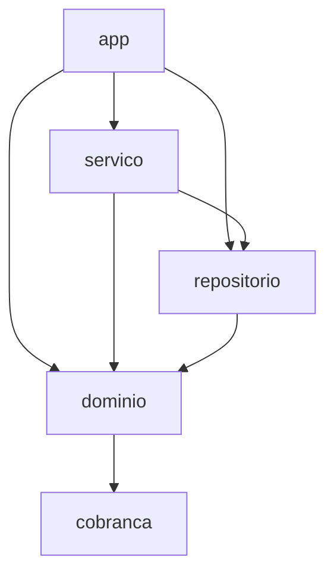

# Sistema Veterinário (Projeto de Demonstração)

Projeto desenvolvido para Fundamentos de Programação Orientada a Objetos — ADS, ULBRA, 2026/2.

O sistema registra entradas e saídas de cachorros e gatos, controla consultórios, calcula a cobrança por espécie e guarda o histórico em CSV. A interface é uma aplicação de console. O projeto completo está na raiz deste repositório.

## Regras de negócio

| Regra | Comportamento |
| :--- | :--- |
| **RN1** | O valor cobrado depende do tipo do animal atendido. |
| **RN2** | Cachorro paga R$ 100,00 fixo. |
| **RN3** | Gato paga R$ 80,00 fixo. |
| **RN4** | A entrada ocupa um consultório livre; sem consultório, a entrada é recusada. |
| **RN5** | A saída cobra pela política escolhida na entrada e libera o consultório após a gravação da cobrança. |
| **RN6** | O nome do animal é obrigatório e não pode ser nulo ou composto apenas por espaços em branco. |
| **RN7** | A saída não pode ser anterior à entrada. Saída igual à entrada é válida. |

A saída exige uma ficha de atendimento aberta. O projeto mantém `double` e compara os valores dos testes com margem `0.001`.

## Como executar em uma máquina limpa

Pré-requisitos:
- Git para clonar o projeto.
- JDK 25 (LTS), conferido com `java -version`.
- Maven 3.9.x, conferido com `mvn -version`.
- Acesso ao Maven Central na primeira compilação para baixar os plugins e o JUnit Jupiter.

Depois de publicar a atualização no GitHub, execute no PowerShell ou Bash:

```bash
git clone <URL_DO_SEU_REPOSITORIO>
cd <PASTA_DO_SEU_REPOSITORIO>
mvn test
mvn compile
java -cp target/classes main.java.br.ulbra.veterinario.app.Main

```

`Main` cria um consultório, escolhe `ArquivoAtendimentoRepositorio(Path.of("dados", "atendimentos.csv"))` e monta o serviço e a apresentação (`ConsoleClinica`). O CSV usa `;`, datas ISO e valor decimal com ponto. Cada saída concluída acrescenta um registro ao arquivo no diretório de execução. O histórico sobrevive a novas instâncias; consultórios ocupados ficam apenas na memória da execução atual.

## Estrutura de pacotes e dependências

As fontes estão em `src/main/java/br/ulbra/veterinario`; os testes seguem a mesma organização em `src/test/java`.

| Pacote | Responsabilidade |
| --- | --- |
| `app` | `Main` monta as dependências; `ConsoleClinica` executa o fluxo, chama o serviço e apresenta resultados e erros. |
| `servico` | `AtendimentoService` coordena as operações do domínio com a gravação dos registros. |
| `dominio` | `Animal`, `Cachorro`, `Gato`, `Consultorio`, `FichaAtendimento`, `ClinicaVeterinaria`, `RegistroAtendimento` e as exceções de negócio. |
| `cobranca` | `PoliticaDeCobranca`, `CobrancaCachorro` e `CobrancaGato`. |
| `repositorio` | `AtendimentoRepositorio`, implementações em memória e arquivo e `RepositorioException`. |

As dependências são `app → servico → dominio`, `servico → repositorio → dominio` e `dominio → cobranca`. A apresentação também importa tipos para compor os objetos, mostrar registros e tratar erros. O domínio não importa `repositorio`.

`Consultorio` e `ClinicaVeterinaria` permanecem no mesmo pacote para usar o construtor e os métodos de alteração com acesso de pacote. A coleção de consultórios é não modificável para quem a consulta.

O polimorfismo tem três pontos comentados no código: decisão em `Animal.criarPoliticaDeCobranca`, armazenamento da referência à interface na `FichaAtendimento` e execução em `FichaAtendimento.finalizar`. `ArquivoAtendimentoRepositorio` concentra as constantes `SEPARADOR`, `TOTAL_COLUNAS` e `FORMATO_LINHA`.

Confira os diagramas de classes e dependências em Mermaid, atualizados com as classes, interfaces, `record` e exceções de produção.

```mermaid
classDiagram
    direction TB

    namespace dominio {
        class VeterinariaException {
            <<exception>>
        }
        class DadosAnimalInvalidosException {
            <<exception>>
        }
        class ConsultorioIndisponivelException {
            <<exception>>
        }
        class HorarioAtendimentoInvalidoException {
            <<exception>>
        }
        class Animal {
            <<abstract>>
            -nome: String
            +getNome(): String
            +getTipo()* String
            +criarPoliticaDeCobranca()* PoliticaDeCobranca
        }
        class Cachorro
        class Gato
        class Consultorio {
            -numero: int
            -animal: Animal
            +estaLivre(): boolean
        }
        class FichaAtendimento {
            -animal: Animal
            -politica: PoliticaDeCobranca
            -entrada: LocalDateTime
            +finalizar(): double
        }
        class RegistroAtendimento {
            <<record>>
            +nomeAnimal: String
            +tipoAnimal: String
            +entrada: LocalDateTime
            +saida: LocalDateTime
            +valorCobrado: double
        }
        class ClinicaVeterinaria {
            -consultorios: List~Consultorio~
            +iniciarAtendimento(a: Animal, entrada: LocalDateTime): FichaAtendimento
            +finalizarAtendimento(f: FichaAtendimento, saida: LocalDateTime): RegistroAtendimento
        }
    }

    namespace cobranca {
        class PoliticaDeCobranca {
            <<interface>>
            +calcularValor()* double
        }
        class CobrancaCachorro
        class CobrancaGato
    }

    namespace servico {
        class AtendimentoService {
            -clinica: ClinicaVeterinaria
            -repositorio: AtendimentoRepositorio
            +iniciarAtendimento(a: Animal, entrada: LocalDateTime): FichaAtendimento
            +encerrarAtendimento(f: FichaAtendimento, saida: LocalDateTime): RegistroAtendimento
            +listarHistorico(): List~RegistroAtendimento~
        }
    }

    namespace repositorio {
        class RepositorioException {
            <<exception>>
        }
        class AtendimentoRepositorio {
            <<interface>>
            +salvar(registro: RegistroAtendimento)* void
            +listarTodos()* List~RegistroAtendimento~
        }
        class MemoriaAtendimentoRepositorio
        class ArquivoAtendimentoRepositorio
    }

    namespace app {
        class ConsoleClinica {
            -service: AtendimentoService
            +executarDemonstracao(): void
        }
        class Main {
            +main(args: String[])$ void
        }
    }

    VeterinariaException <|-- DadosAnimalInvalidosException
    VeterinariaException <|-- ConsultorioIndisponivelException
    VeterinariaException <|-- HorarioAtendimentoInvalidoException

    Animal <|-- Cachorro
    Animal <|-- Gato
    Animal ..> DadosAnimalInvalidosException : lança
    ClinicaVeterinaria "1" *-- "1..*" Consultorio
    ClinicaVeterinaria ..> ConsultorioIndisponivelException : lança
    ClinicaVeterinaria ..> HorarioAtendimentoInvalidoException : lança

    PoliticaDeCobranca <|.. CobrancaCachorro
    PoliticaDeCobranca <|.. CobrancaGato
    FichaAtendimento --> PoliticaDeCobranca

    AtendimentoRepositorio <|.. MemoriaAtendimentoRepositorio
    AtendimentoRepositorio <|.. ArquivoAtendimentoRepositorio
    ArquivoAtendimentoRepositorio ..> RepositorioException : lança

    AtendimentoService --> ClinicaVeterinaria
    AtendimentoService --> AtendimentoRepositorio
    ConsoleClinica --> AtendimentoService
    ConsoleClinica ..> VeterinariaException : captura
    ConsoleClinica ..> RepositorioException : captura
    Main ..> ConsoleClinica : inicia
    Main ..> AtendimentoService : monta
    Main ..> ArquivoAtendimentoRepositorio : instancia

```





## Erros e tratamento

| Situação | Exceção | Camada que lança | Camada que trata | Mensagem ao usuário |
| --- | --- | --- | --- | --- |
| Contrato comum das violações de negócio | `VeterinariaException` | Domínio, por meio das subclasses; a base não é lançada diretamente | Apresentação (`ConsoleClinica`) | `-> Erro de negócio tratado: <mensagem da subclasse>` |
| Nome do animal nulo ou em branco | `DadosAnimalInvalidosException` | Domínio (`Animal`) | Apresentação | `Nome do animal inválido: não pode ser vazio. Informe um nome válido para o cadastro.` |
| Nenhuma vaga de consultório livre | `ConsultorioIndisponivelException` | Domínio (`ClinicaVeterinaria`) | Apresentação | `Todos os consultórios estão ocupados no momento. Finalize um atendimento antes de iniciar outro.` |
| Saída anterior à entrada | `HorarioAtendimentoInvalidoException` | Domínio (`ClinicaVeterinaria`) | Apresentação | `Horário de saída inválido: não pode ser anterior à entrada. Informe um horário igual ou posterior à entrada.` |
| Falha de leitura, gravação ou linha inválida no CSV | `RepositorioException` | Repositório (`ArquivoAtendimentoRepositorio`) | Apresentação | `Falha técnica ao gravar/ler arquivo de atendimentos...` |

As exceções de negócio são não verificadas e herdam de `VeterinariaException`. O erro técnico `RepositorioException` tem hierarquia separada e preserva a causa quando ela existe. O `try/catch` fica na camada de apresentação (`ConsoleClinica`), garantindo que erros previstos mostrem uma mensagem e o fluxo continue disponível.

## Decisões de projeto

| Contexto | Decisão | Consequência |
| --- | --- | --- |
| Cobranças variam conforme o tipo | Interface `PoliticaDeCobranca`; a ficha recebe a política no construtor | A ficha executa a cobrança sem selecionar o tipo novamente |
| Ocupação precisa permanecer sob controle | Composição de `Consultorio` em `ClinicaVeterinaria`, acesso de pacote e lista não modificável | A consulta não permite remover ou substituir consultórios |
| Persistência não é regra de domínio | O serviço usa `AtendimentoRepositorio`; o `record` fica no domínio | Memória e CSV usam o mesmo contrato; domínio não importa `repositorio` |
| Erros de negócio e técnicos precisam de mensagens diferentes | Exceções não verificadas, base comum de negócio e exceção técnica separada | A apresentação trata os erros previstos e continua recebendo operações |
| Falhas não devem deixar uma saída pela metade | Validar horário de saída antes de finalizar a ficha e liberar o consultório | Uma falha de validação permite nova tentativa com o consultório ainda ocupado |
| Constantes de CSV repetidas podem divergir | Constantes `SEPARADOR`, `TOTAL_COLUNAS` e `FORMATO_LINHA` | Os literais têm uma definição; leitura e escrita compartilham o mesmo layout |

Os mesmos registros estão detalhados em `docs/melhorias.md`, no formato Contexto → Decisão → Consequência.

## Como o código evolui

| Tag | Encontro | Evolução |
| --- | --- | --- |
| `v11` | 11 — Reciclagem | Pacote único, herança, interface, polimorfismo, composição e testes unitários iniciais. |
| `v12` | 12 — Pacotes e repositório | Pacotes por responsabilidade, `record` e persistência por memória ou CSV com `@TempDir`. |
| `v13` | 13 — Exceções e camadas | Exceções próprias, serviço, apresentação e raiz de composição. O `record` vai para o domínio e o serviço usa o repositório. |
| `v14` | 14 — Testes, refatoração e documentação | Cobrança parametrizada e casos-limite, polimorfismo na escolha da cobrança e constantes CSV. Documentação e diagramas atualizados. |

Com o trabalho local salvo, navegue pelas aulas:

```bash
git checkout v12
mvn clean test
git checkout main

```

As tags abrem uma versão de estudo em estado destacado (*detached HEAD*). Ao trocar de versão, use `mvn clean test` para remover classes compiladas de pacotes antigos. As tags `v11`, `v12` e `v13` foram preservadas; a tag `v14` identifica o estado do Encontro 14.

## Diagrama de classes

## Saídas reais da verificação

Trecho final copiado da execução de `mvn test`:

```text
[INFO] Results:
[INFO]
[INFO] Tests run: 16, Failures: 0, Errors: 0, Skipped: 0
[INFO]
[INFO] ------------------------------------------------------------------------
[INFO] BUILD SUCCESS
[INFO] ------------------------------------------------------------------------

```

Saída copiada da execução do `Main`:

```text
=== INICIANDO ATENDIMENTOS NA CLÍNICA (1 CONSULTÓRIO) ===

[Tentativa 1] Cadastrando animal com nome em branco...
-> Erro de negócio tratado: Nome do animal inválido: não pode ser vazio. Informe um nome válido para o cadastro.
-> Consultórios livres após Tentativa 1: 1

[Sucesso] Atendimento iniciado para Rex. Consultórios livres: 0

[Tentativa 2] Tentando iniciar atendimento para Mingau sem consultório livre...
-> Erro de negócio tratado: Todos os consultórios estão ocupados no momento. Finalize um atendimento antes de iniciar outro.
-> Consultórios livres após Tentativa 2: 0

[Tentativa 3] Tentando encerrar atendimento de Rex com horário anterior à entrada...
-> Erro de negócio tratado: Horário de saída inválido: não pode ser anterior à entrada. Informe um horário igual ou posterior à entrada.
-> Consultórios livres após Tentativa 3 (estado preservado): 0

[Sucesso] Atendimento finalizado: Rex (CACHORRO) - Valor: R$ 100.00
-> Consultórios livres ao fim: 1
-> Total de registros persistidos no histórico: 1

```

Os testes usam horários fixos e diretórios `@TempDir`. O registro de melhorias apresenta os casos adicionados e a falha observada antes da correção.

## Documentação e uso de IA

* `docs/melhorias.md` — Melhorias do Encontro 14.
* `docs/uml.png` — Diagrama de classes atualizado.
* `AI.md` — Registro de uso de IA.

Gemini foi usado para ampliar os testes, executar as refatorações solicitadas e atualizar a documentação. O domínio, as regras de negócio e os requisitos dos encontros foram validados e revisados localmente.

```

```
