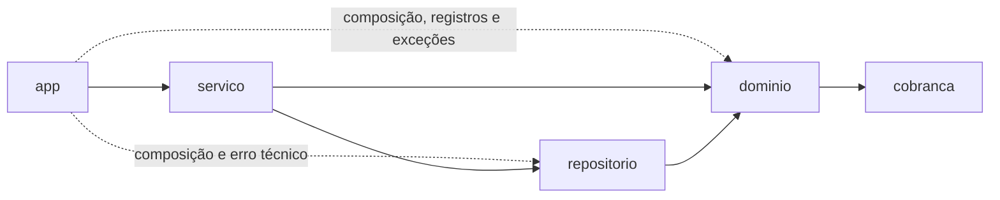

## Diagramas — estado v14

Os diagramas Mermaid representam as classes de produção e suas dependências.

### Classes

```mermaid
classDiagram
    namespace dominio {
        class VeterinariaException {
            <<exception>>
        }
        class DadosAnimalInvalidosException {
            <<exception>>
        }
        class ConsultorioIndisponivelException {
            <<exception>>
        }
        class HorarioAtendimentoInvalidoException {
            <<exception>>
        }
        class Animal {
            <<abstract>>
            -nome: String
            +getNome(): String
            +getTipo()* String
            +criarPoliticaDeCobranca()* PoliticaDeCobranca
        }
        class Cachorro
        class Gato
        class Consultorio {
            -numero: int
            -animal: Animal
            +estaLivre(): boolean
        }
        class FichaAtendimento {
            -animal: Animal
            -politica: PoliticaDeCobranca
            -entrada: LocalDateTime
            +finalizar(): double
        }
        class RegistroAtendimento {
            <<record>>
            +nomeAnimal: String
            +tipoAnimal: String
            +entrada: LocalDateTime
            +saida: LocalDateTime
            +valorCobrado: double
        }
        class ClinicaVeterinaria {
            -consultorios: List~Consultorio~
            +iniciarAtendimento(a: Animal, entrada: LocalDateTime): FichaAtendimento
            +finalizarAtendimento(f: FichaAtendimento, saida: LocalDateTime): RegistroAtendimento
        }
    }

    namespace cobranca {
        class PoliticaDeCobranca {
            <<interface>>
            +calcularValor()* double
        }
        class CobrancaCachorro
        class CobrancaGato
    }

    namespace servico {
        class AtendimentoService {
            -clinica: ClinicaVeterinaria
            -repositorio: AtendimentoRepositorio
            +iniciarAtendimento(a: Animal, entrada: LocalDateTime): FichaAtendimento
            +encerrarAtendimento(f: FichaAtendimento, saida: LocalDateTime): RegistroAtendimento
            +listarHistorico(): List~RegistroAtendimento~
        }
    }

    namespace repositorio {
        class RepositorioException {
            <<exception>>
        }
        class AtendimentoRepositorio {
            <<interface>>
            +salvar(registro: RegistroAtendimento)* void
            +listarTodos()* List~RegistroAtendimento~
        }
        class MemoriaAtendimentoRepositorio
        class ArquivoAtendimentoRepositorio
    }

    namespace app {
        class ConsoleClinica {
            -service: AtendimentoService
            +executarDemonstracao(): void
        }
        class Main {
            +main(args: String[])$ void
        }
    }

    VeterinariaException <|-- DadosAnimalInvalidosException
    VeterinariaException <|-- ConsultorioIndisponivelException
    VeterinariaException <|-- HorarioAtendimentoInvalidoException

    Animal <|-- Cachorro
    Animal <|-- Gato
    Animal ..> DadosAnimalInvalidosException : lança
    ClinicaVeterinaria "1" *-- "1..*" Consultorio
    ClinicaVeterinaria ..> ConsultorioIndisponivelException : lança
    ClinicaVeterinaria ..> HorarioAtendimentoInvalidoException : lança

    PoliticaDeCobranca <|.. CobrancaCachorro
    PoliticaDeCobranca <|.. CobrancaGato
    FichaAtendimento --> PoliticaDeCobranca

    AtendimentoRepositorio <|.. MemoriaAtendimentoRepositorio
    AtendimentoRepositorio <|.. ArquivoAtendimentoRepositorio
    ArquivoAtendimentoRepositorio ..> RepositorioException : lança

    AtendimentoService --> ClinicaVeterinaria
    AtendimentoService --> AtendimentoRepositorio
    ConsoleClinica --> AtendimentoService
    ConsoleClinica ..> VeterinariaException : captura
    ConsoleClinica ..> RepositorioException : captura
    Main ..> ConsoleClinica : inicia
    Main ..> AtendimentoService : monta
    Main ..> ArquivoAtendimentoRepositorio : instancia
```

`consultorios` mantém a composição das salas de atendimento (`List<Consultorio>`). A operação `FichaAtendimento.finalizar` apenas calcula o valor pela política armazenada; `ClinicaVeterinaria.finalizarAtendimento` valida o horário, libera o consultório e gera o `RegistroAtendimento`, enquanto `AtendimentoService` coordena a persistência no repositório. Os campos do `record` representam seus componentes, acessíveis pelos métodos gerados `nomeAnimal()`, `tipoAnimal()`, `entrada()`, `saida()` e `valorCobrado()`.

### Dependências entre pacotes

As setas indicam dependências de código. O domínio não importa `repositorio`. As dependências adicionais de `app` permitem montar os objetos na raiz de composição (`Main`) e apresentar registros e erros (`ConsoleClinica`).
